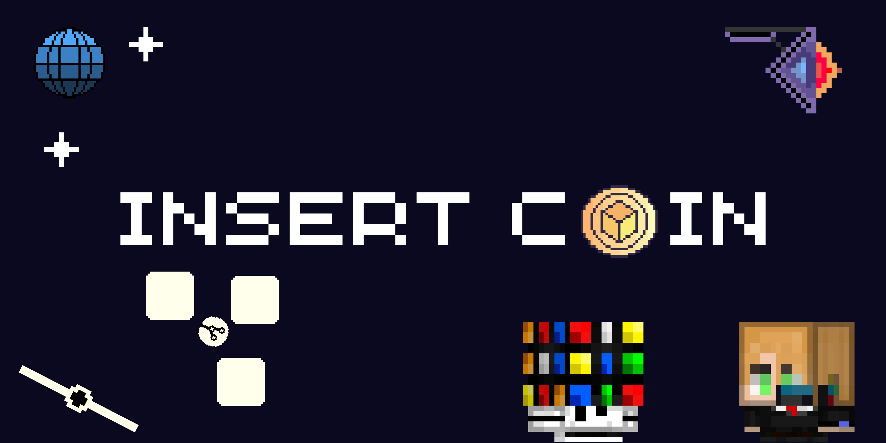

<h1>
Insert Coin
</h1>

_"a collection of arcade minigames that run on your desktop"_

## Description

<b>Insert Coin</b> is a collection of mini arcade games designed to make the desktop gaming experience more engaging while sharpening my programming and game design skills. Every minigame is themed around IT concepts transforming everyday developer struggles like fixing bugs or rushing commits into fun, fast paced arcade challenges!

## How I Built This / Story
This game stems from my desire to hone my skills in developing unique game mechanics for game jams. While some games are inevitably inspired by existing titles, I strive to make mine distinct for instance, *GitHub Breaker* (a take on *Block Breaker*) incorporates a theme based on a developer’s daily GitHub commits, while *Commit Rush* a Quick Time Event (QTE) style game revolves around the experience of working within a terminal interface. Furthermore, by designing games that can run directly on the desktop, I aim to offer something truly unique; rather than simply copying other games, I seek inspiration by exploring how I might reimagine those concepts through my own personal style.

## How To Play

- __Github Breaker__,
You play using a paddle that can be moved left and right to break blocks with a ball.

- __360 Core Shield__,
You protect the internet orb located in the center using the left and right buttons to prevent bugs from getting in.

- __Bug Hunter__,
You play as a cursor that must avoid red bugs while defeating green and gold bugs, controlling the cursor using the left, right, down, and up buttons.

- __Commit Rush__,
You are challenged to press the buttons indicated on the screen such as Enter, Space, the up arrow, and so on as quickly as possible.

## Tech Stack
- __Godot__, the game engine used to create this game
- __Pixel Studio__, an application for me to draw pixel art assets for these games
- __Canva__, to edit the assets that I have created into a logo or banner

## 🚀 How to Play Locally

- Download the latest build from [Itch.io](https://rubiriku-dev.itch.io/insert-coin).
2. Extract the `.zip` file.
3. Run `Insert Coin.exe` and enjoy!

My Project Stardance 🌟 Rubikuriku

